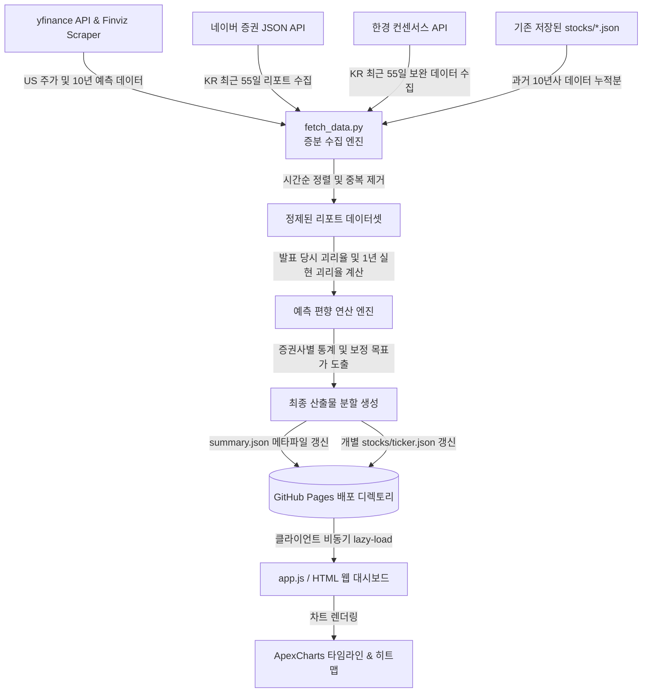
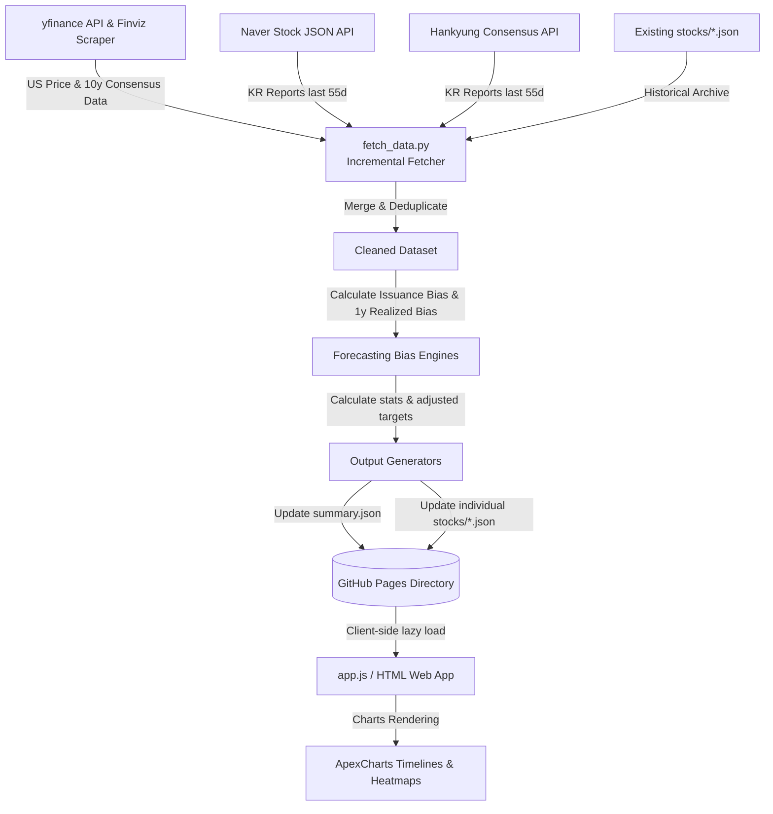

# 📊 Stock Consensus & Bias Analytics Dashboard (주식 컨센서스 예측 분석 시스템)

A premium interactive dashboard that collects, cleans, and analyzes analyst target prices and actual price histories for 42 major US/KR stocks. It computes historical analyst forecasting bias and estimates realistic, bias-adjusted investment targets.

증권사 및 애널리스트들의 목표가 예측 데이터를 전수 수집·분석하여, 각 증권사별 과거 편향(Bias)을 계량화하고 이를 보정한 **현실적 투자 목표가(Realistic Target)**와 발표 당시의 **진짜 괴리율**을 실시간으로 시각화하는 인터랙티브 대시보드입니다.

🌐 **Live Dashboard (라이브 데모)**:
- 🇰🇷 **Korean Version (국문판)**: [https://eljja.github.io/Consensus/](https://eljja.github.io/Consensus/)
- 🇺🇸 **English Version (영문판)**: [https://eljja.github.io/Consensus/index_en.html](https://eljja.github.io/Consensus/index_en.html)

---

## 🗺️ Table of Contents (목차)
- [🇰🇷 한국어 문서 (Korean Documentation)](#-한국어-문서-korean-documentation)
  - [1. 프로젝트 소개 및 특징](#1-프로젝트-소개-및-특징)
  - [2. 핵심 모델 및 분석 전략 (Methodology)](#2-핵심-모델-및-분석-전략-methodology)
  - [3. 데이터 파이프라인 및 아키텍처](#3-데이터-파이프라인-및-아키텍처)
  - [4. 현재 개발 및 데이터 반영 현황](#4-현재-개발-및-데이터-반영-현황)
  - [5. 실행 주기 및 로컬 실행 가이드](#5-실행-주기-및-로컬-실행-가이드)
- [🇺🇸 English Documentation (영문 Documentation)](#-english-documentation-영문-문서)
  - [1. Project Overview & Features](#1-project-overview--features)
  - [2. Core Methodology & Strategy](#2-core-methodology--strategy)
  - [3. Data Pipeline & Architecture](#3-data-pipeline--architecture)
  - [4. Project Status & Milestones](#4-project-status--milestones)
  - [5. Execution Cycles & Local Development Guide](#5-execution-cycles--local-development-guide)
- [⚠️ Disclaimer (면책 사항)](#️-disclaimer-면책-사항)
- [📜 License](#-license)

---

# 🇰🇷 한국어 문서 (Korean Documentation)

## 1. 프로젝트 소개 및 특징
본 프로젝트는 국내외 42대 대표 기업(미국 빅테크 21개 + 한국 시총 상위 21개)에 대하여 발표된 증권사 리포트 데이터를 분석합니다. 증권사의 지나치게 낙관적인 예측 관행(Bullish Bias)을 객관적인 데이터로 검증하고 보정하는 것을 목적으로 합니다.

- **글래스모피즘 디자인 & 통합 시맨틱 컬러**: 다크 모드 기관급 금융 터미널 UI(상승여력: 에메랄드, 하방위험: 로즈) 및 `tabular-nums` 숫자 정렬.
- **다국어 및 실시간 환율 지원**: 한국어/영어 전환(종목 딥링크 `?ticker=` 보존) 및 `yfinance(KRW=X)` 실시간 USD/KRW 환율 자동 연동.
- **종목 탐색 허브 & 42종목 스크리너**: 마켓 펄스(상·하위 기회), 42종목 비교 스크리너 모달(혼합 통화 USD 정규화 정렬), 커맨드 팔레트(`/` 또는 `Ctrl+K`) 지원.
- **비동기 지연 로딩(Lazy Loading)**: 경량 메타데이터(`summary.json`)와 개별 종목 JSON(`stocks/*.json`) 분리로 빠른 초기 로딩 달성.
- **구글 SEO 최적화**: Google Search Console 인증, Schema.org JSON-LD 구조화 데이터, 다국어 Hreflang 태그, Open Graph 및 Twitter Cards 지원.

---

## 2. 핵심 모델 및 분석 전략 (Methodology)

### A. 발표 당시 괴리율 (Issuance Bias %)
과거 리포트의 괴리율을 오늘의 주가와 비교하는 왜곡을 제거하고, **리포트가 발간된 그 당일의 주가**와 비교하여 증권사가 실제로 부여했던 목표 프리미엄을 정확히 계산합니다.
$$\text{발표 당시 괴리율 (\%)} = \frac{\text{목표가 (Target Price)} - \text{발표 당일 주가 (Price on Report Date)}}{\text{발표 당일 주가 (Price on Report Date)}} \times 100$$

- **차트 괴리율(%) 모드**: Y축의 0%선(Baseline)이 '발표 당일 주가'를 나타내므로, 증권사가 시점별로 주가 대비 얼마나 높은 프리미엄을 부여했는지 왜곡 없이 비교 가능합니다.

### B. 편향 보정 현실적 목표가 (Realistic Target Price)
각 증권사별로 발표한 리포트의 **3개월 실현 괴리율(3-Month Realized Bias)**을 기반으로 증권사별 고유 편향 지수(Bias Index)를 산출하고, 이를 바탕으로 생(Raw) 목표가를 합리적으로 보정합니다.
$$\text{보정 목표가 } (T_{adj}) = \frac{\text{발표 목표가 } (T_{raw})}{1 + \frac{\text{증권사 평균 편향 } (B_{shrunk})}{100}}$$

- **2년 최근성 가중 베이지안 편향 수축 (Recency-Weighted Bayesian Shrinkage)**: 과거 10년 데이터를 동일하게 취급하지 않고 반감기 2년의 지수 감쇄를 적용해 최근 정확도에 더 높은 가중치를 부여하며, 표본이 적은 증권사는 글로벌 최근성 편향으로 수축합니다 ($k=5$).
- **윈저라이징(10~90%) 및 이상치 차단**: 자릿수 오타(직전 목표가 대비 75% 초과 급락) 및 극단치(`0.20x ~ 3.5x`)를 제거해 평균 및 레인지 게이지 왜곡을 방지합니다.
- **의견 일치도 (Consensus Dispersion)**: 보정 목표가의 사분위 범위(`IQR / Median`)로 애널리스트 합의 수준을 시각화합니다.

### C. 🎯 Hybrid v2 — 3개월 후 주가 예측 모델 (3-Month Stock Price Prediction)
2021~2026년 Walk-Forward Out-of-Sample 백테스트(Holdout 2024~2026, $n=1,222$)로 검증된 **3-팩터 하이브리드 예측 모델**을 적용했습니다.
$$\hat{r}_{3m} = \text{clip}\!\left(0.010 + 0.5 \cdot \alpha_i \cdot \frac{T_{\text{adj}} - P_{\text{now}}}{P_{\text{now}}} + 0.025 \cdot B_{\text{rev}},\ -0.18,\ +0.22\right)$$
$$\hat{P}_{3m} = P_{\text{now}} \cdot (1 + \hat{r}_{3m}), \qquad \text{68\% 신뢰구간} = \hat{P}_{3m} \cdot \left(1 \pm \sigma_i \sqrt{\frac{90}{365}}\right)$$
- **동적 변동성 수렴 계수 ($\alpha_i$)**: 1년 연율화 변동성($\sigma_i$) 연동 $\alpha_i = \text{clip}\left(0.05 \times \frac{\sigma_i}{\bar{\sigma}}, 0.02, 0.10\right)$.
- **애널리스트 리비전 모멘텀 ($B_{\text{rev}}$)**: 최근 90일 목표가 상향 vs 하향 비율 $\frac{N_{\text{up}} - N_{\text{down}}}{N_{\text{up}} + N_{\text{down}}}$을 반영해 방향성을 크게 개선했습니다.
- **Out-of-Sample 검증 성과 (2024–2026 Holdout)**: 방향 적중률 **58.2%** (기존 45.5% 대비 +12.7%p), **sMAPE 14.57%** (랜덤워크 14.80% 상회), 68% 신뢰구간 실제 커버리지 **69.1%**.

---

## 3. 데이터 파이프라인 및 아키텍처

시스템은 데이터 갱신 비용을 극적으로 낮추기 위해 **증분 수집 및 병합 엔진**으로 구현되어 있습니다.



---

## 4. 현재 개발 및 데이터 반영 현황
- **관리 종목 수**: **총 42개 대표 종목** (미국 21개 + 한국 21개)
  - 🇺🇸 **미국**: NVDA, AAPL, GOOGL, MSFT, AMZN, AVGO, META, TSLA, LLY, JPM, WMT, AMD, V, MA, COST, ORCL, KO, NFLX, **SNDK(SanDisk)**, PEP, DIS
  - 🇰🇷 **한국**: 삼성전자, SK하이닉스, 현대차, **삼성전기**, LG에너지솔루션, 삼성바이오로직스, 삼성물산, KB금융, 삼성생명, 기아, 신한지주, 두산에너빌리티, 현대모비스, 셀트리온, 삼성SDI, NAVER, 삼성화재, POSCO홀딩스, LG화학, 한국전력, 카카오
- **누적 데이터 규모**: 미국/한국 대표 42대 기업의 **`20,936건`** 애널리스트 리포트 데이터셋 및 **191개 증권사** 편향 분석 완료.
- **완료된 마일스톤**:
  1. 한국어/영어 다국어 이원화 및 통화 실시간 변환 엔진 탑재.
  2. 차트 기본 축을 **로그 축(Log Scale)**으로 설정하여 급격한 주가 변화율 왜곡 극복.
  3. 차트 겹침 가독성을 해결하기 위해 **Scatter(점) 투명도 50% 적용** 및 **주가 선 최상단 레이어 배치** 완료.
  4. GitHub Actions를 통한 **주간 자동 데이터 업데이트 워크플로우** 구축 (매주 금요일 16:00 UTC / 토요일 01:00 KST).
  5. 구글 검색엔진 최적화(SEO): Schema.org JSON-LD 구조화 데이터, Hreflang 다국어 링크, Open Graph 및 `sitemap.xml` 완비.

---

## 5. 실행 주기 및 로컬 실행 가이드

### A. 데이터 업데이트 주기
- 본 저장소의 데이터는 GitHub Actions를 통해 매주 금요일 장 마감 후 자동으로 갱신됩니다.
- 증분 수집 방식이 적용되어 매 실행 시 단 3~4분 만에 42개 종목의 실시간 주가와 신규 리포트 병합이 완료됩니다.

### B. 로컬 설치 및 실행 방법
1. 저장소 클론 및 패키지 설치:
   ```bash
   git clone https://github.com/eljja/Consensus.git
   cd Consensus
   pip install -r requirements.txt
   ```
2. 데이터 수집 및 가공 스크립트 실행:
   ```bash
   python fetch_data.py
   ```
3. 로컬 테스트 서버 구동 (혹은 index.html을 브라우저로 직접 실행):
   ```bash
   # Python 기본 서버 예시
   python -m http.server 8000
   # 이후 브라우저에서 http://localhost:8000 접속
   ```

---

# 🇺🇸 English Documentation (영문 문서)

## 1. Project Overview & Features
This repository features an interactive dark-mode analytics dashboard tracking forecasting accuracy, bias patterns, and true target premiums for 42 leading US and South Korean stocks.

- **Bilingual & Live Multi-currency**: Instant KO/EN switching (preserving `?ticker=` deep links) with live USD/KRW FX rate fetched automatically via `yfinance (KRW=X)`.
- **Discovery Hub, Screener & Quick Jump**: Market pulse opportunities, 42-stock FX-normalized comparison screener modal, and keyboard Command Palette (`/` or `Ctrl+K`).
- **Asynchronous Lazy Loading**: Loads lightweight `summary.json` first and fetches individual `stocks/{ticker}.json` files on demand.
- **Google SEO Optimization**: Verified with Google Search Console, Schema.org JSON-LD, hreflang alternates, Open Graph, and Twitter Cards.

---

## 2. Core Methodology & Strategy

### A. Issuance Bias (%)
Calculates target price premium against the **stock close price on the actual report publication date** to eliminate historical timeline bias.
$$\text{Issuance Bias (\%)} = \frac{\text{Target Price} - \text{Price on Report Date}}{\text{Price on Report Date}} \times 100$$

### B. Bias-Adjusted Realistic Target Prices
Computes each brokerage's historical **3-Month Realized Bias** to calculate their unique bias factor. The raw target prices are adjusted using this factor:
$$\text{Adjusted Target } (T_{adj}) = \frac{\text{Raw Target } (T_{raw})}{1 + \frac{\text{Firm Average Bias } (B_{shrunk})}{100}}$$

- **2-Year Recency-Weighted Bayesian Shrinkage**: Weights historical realized firm bias with a 2-year half-life and shrinks low-sample estimates toward global recency-weighted firm bias ($k=5$), combined with 10–90% Winsorization and digit-drop typo filtering.

### C. 🎯 Hybrid v2 — 3-Month Stock Price Prediction Model
Validated strictly out-of-sample across 2021–2026 walk-forward snapshots (2024–2026 holdout, $n=1,222$):
$$\hat{r}_{3m} = \text{clip}\!\left(0.010 + 0.5 \cdot \alpha_i \cdot \frac{T_{\text{adj}} - P_{\text{now}}}{P_{\text{now}}} + 0.025 \cdot B_{\text{rev}},\ -0.18,\ +0.22\right)$$
$$\hat{P}_{3m} = P_{\text{now}} \cdot (1 + \hat{r}_{3m}), \qquad \text{68\% CI} = \hat{P}_{3m} \cdot \left(1 \pm \sigma_i \sqrt{\frac{90}{365}}\right)$$
- **Dynamic Volatility Convergence ($\alpha_i$)**: Scales with 1-year annualized volatility ($\sigma_i$): $\alpha_i = \text{clip}\left(0.05 \times \frac{\sigma_i}{\bar{\sigma}}, 0.02, 0.10\right)$.
- **Analyst Revision Momentum ($B_{\text{rev}}$)**: Captures 90-day target upgrade vs downgrade breadth $\frac{N_{\text{up}} - N_{\text{down}}}{N_{\text{up}} + N_{\text{down}}}$.
- **Holdout Performance (2024–2026)**: **58.2%** directional accuracy (+12.7%p vs prior 45.5%), **14.57% sMAPE** (beating 14.80% random walk), and **69.1%** empirical coverage for the 68% confidence band.

---

## 3. Data Pipeline & Architecture



---

## 4. Project Status & Milestones
- **Stock Coverage**: **42 Major Stocks** (21 US + 21 KR)
  - 🇺🇸 **US**: NVDA, AAPL, GOOGL, MSFT, AMZN, AVGO, META, TSLA, LLY, JPM, WMT, AMD, V, MA, COST, ORCL, KO, NFLX, **SNDK (SanDisk)**, PEP, DIS
  - 🇰🇷 **KR**: Samsung Electronics, SK Hynix, Hyundai Motor, **Samsung Electro-Mechanics**, LG Energy Solution, Samsung Biologics, Samsung C&T, KB Financial, Samsung Life, Kia, Shinhan Financial, Doosan Enerbility, Hyundai Mobis, Celltrion, Samsung SDI, NAVER, Samsung Fire & Marine, POSCO Holdings, LG Chem, KEPCO, Kakao
- **Consensus Size**: **`20,936`** individual analyst reports across **191 brokerage firms**.
- **Completed Milestones**:
  - English/Korean translations and USD/KRW conversion engine implemented.
  - Active logarithmic (Log Scale) chart defaults.
  - Render enhancements: Scatter dot opacity set to 50% for high density visibility, with the price line locked at the absolute front layer.
  - Automated weekly update via GitHub Actions workflow (`daily_update.yml`).
  - Google SEO optimization: Structured Data JSON-LD, Hreflang alternates, Open Graph, and `sitemap.xml`.

---

## 5. Execution Cycles & Local Development Guide

### A. Execution Cycle
- Data is automatically refreshed weekly on Friday after market close via GitHub Actions.
- Thanks to the optimized incremental fetcher, scanning and generating all JSONs takes only **3 to 4 minutes**.

### B. Setup & Local Run
1. Install dependencies:
   ```bash
   pip install -r requirements.txt
   ```
2. Fetch and generate fresh datasets:
   ```bash
   python fetch_data.py
   ```
3. Run local testing server:
   ```bash
   python -m http.server 8000
   # Open http://localhost:8000 in your browser
   ```

---

## ⚠️ Disclaimer (면책 사항)
All data and analytics provided in this project are for educational and informational purposes only and do not constitute financial or investment advice.

본 프로젝트의 모든 데이터 분석 결과는 참고용이며, 어떠한 경우에도 투자 권유나 법적 책임의 근거로 사용될 수 없습니다.

---

## 📜 License
This project is licensed under the **Apache License 2.0** - see the [LICENSE](LICENSE) file for details.

